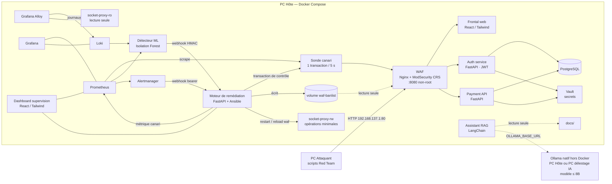

# PROJECT RESILIENCE-ALPHA — Groupe 16

> Workshop national Bac+5 EPSI 2026-27 · Cyber-résilience et reprise autonome
> Consortium **G16** · Livrables : `Workshop2026-M2-G16-*`

Démonstrateur d'une **plateforme de paiement fictive** capable de subir une attaque, de détecter l'anomalie par **machine learning**, puis de **se rétablir sans intervention humaine** (*Zero-Touch Recovery*). La reprise est prouvée par l'exécution réussie d'une **nouvelle transaction fictive** après l'incident.

> ⚠️ **Environnement de laboratoire.** Toutes les données, transactions et identités sont fictives. Aucune donnée bancaire réelle. Les actions offensives sont strictement limitées au SI du groupe 16 et aux machines du consortium (réseau `RESILIENCE-G16`).

> **Où en est le projet ?** Voir l'[état des lieux](docs/etat-des-lieux.md) (fait, à faire, priorités). **Comment l'utiliser ?** Voir la [section 7](#7-utiliser-et-vérifier-la-plateforme).

---

## Sommaire

1. [Équipe](#1-équipe)
2. [Architecture](#2-architecture)
3. [Structure du dépôt](#3-structure-du-dépôt)
4. [Prérequis](#4-prérequis)
5. [Réseau du consortium](#5-réseau-du-consortium)
6. [Installation et démarrage](#6-installation-et-démarrage)
7. [Utiliser et vérifier la plateforme](#7-utiliser-et-vérifier-la-plateforme)
8. [Scénario de démonstration](#8-scénario-de-démonstration)
9. [Détection par machine learning](#9-détection-par-machine-learning)
10. [Moteur de remédiation](#10-moteur-de-remédiation)
11. [Assistant opérateur (RAG)](#11-assistant-opérateur-rag)
12. [Sécurité](#12-sécurité)
13. [Gouvernance](#13-gouvernance)
14. [Tests](#14-tests)
15. [Règles de contribution](#15-règles-de-contribution)
16. [Livrables](#16-livrables)
17. [Limites connues](#17-limites-connues)
18. [Contributions](#18-contributions)

---

## 1. Équipe

| Membre | GitHub |
|---|---|
| Mouffid ABAYOMI | [@abayomimouffid9](https://github.com/abayomimouffid9) |
| Zied BOUNOUR | [@Eidlike](https://github.com/Eidlike) |
| Papa Cheikh GNINGUE | [@PapaCheikh](https://github.com/PapaCheikh) |
| Mattheo COPPIN | [@Zagoki](https://github.com/Zagoki) |
| Ayoub FATHALLAH | [@Formidabledu59](https://github.com/Formidabledu59) |

Pas de rôle attitré : chaque membre intervient sur l'ensemble des piliers. La contribution de chacun est traçable via l'historique Git et détaillée en fin de projet dans la section [Contributions](#18-contributions).

---

## 2. Architecture



### Boucle de reprise autonome

1. **Collecte** : Prometheus scrape toutes les 5 s les métriques des services FastAPI (port `8000`, `/metrics`), de la sonde canari et de la stack d'observabilité ; Alloy envoie les journaux des conteneurs à Loki. Ne sont volontairement **pas** scrapés :
   - PostgreSQL et Vault : la santé de la base est couverte par le canari, qui exécute une vraie transaction ;
   - `frontend`, `dashboard` et `assistant-rag` : fichiers statiques ou Streamlit, sans `/metrics` natif ;
   - le WAF : pas d'exporter, les métriques de blocage viendront des logs ModSecurity dans Loki.
2. **Détection** : le détecteur ML calcule un score d'anomalie toutes les 5 secondes sur une fenêtre glissante de métriques.
3. **Décision** : au-delà du seuil, une alerte signée est envoyée au moteur de remédiation, qui choisit le playbook adapté au type d'incident.
4. **Action** : exécution du playbook Ansible (ban de l'IP source au WAF, relance du service touché).
5. **Vérification** : le moteur attend que la métrique du canari dans Prometheus retrouve un taux de succès nominal, puis demande au canari une transaction de contrôle. L'incident n'est clôturé que si elle aboutit.

> Un conteneur qui redémarre n'est **pas** considéré comme une reprise. Seule une transaction métier réussie l'est.

### Composants

| Service | Techno | Rôle | Exposition |
|---|---|---|---|
| `waf` | Nginx + ModSecurity (OWASP CRS) | Point d'entrée unique, filtrage, rate-limit, liste de bannissement | `192.168.137.1:80` → `8080` |
| `frontend` | React + Tailwind | Interface client de paiement, pages RGPD et CGU, 404 personnalisée | via WAF |
| `auth-service` | FastAPI | Authentification, émission de JWT | via WAF |
| `payment-api` | FastAPI | Création et traitement des transactions | via WAF |
| `postgres` | PostgreSQL | Données métier fictives | réseau interne uniquement |
| `vault` | HashiCorp Vault | Secrets (identifiants BDD, clés JWT, tokens) | réseau interne uniquement |
| `canary` | Python | Transaction fictive périodique, métrique de succès, transaction de contrôle à la demande | réseau interne uniquement |
| `prometheus` | Prometheus | Métriques (hors `postgres` et `vault`, couverts par le canari) | `127.0.0.1:9090` |
| `alertmanager` | Alertmanager | Routage des alertes | réseau interne uniquement |
| `loki` | Loki | Journaux centralisés | réseau interne uniquement |
| `alloy` | Grafana Alloy | Collecte des journaux des conteneurs vers Loki | réseau interne uniquement |
| `grafana` | Grafana | Visualisation, dashboards SOC | `127.0.0.1:3000` |
| `ml-detector` | Python · scikit-learn | Détection d'anomalies | réseau interne uniquement |
| `remediation-engine` | FastAPI + Ansible | Décision, action, vérification | réseau interne uniquement |
| `socket-proxy-ro` | docker-socket-proxy | Accès Docker en lecture seule pour Alloy (`CONTAINERS=1`, `POST=0`) | réseau interne uniquement |
| `socket-proxy-rw` | docker-socket-proxy | Accès Docker minimal (restart / reload) pour la remédiation | réseau interne uniquement |
| `dashboard` | React + Tailwind | Supervision avant / pendant / après | `127.0.0.1:5173` |
| `assistant-rag` | LangChain + base vectorielle | Aide aux opérateurs | `127.0.0.1:8501` |

Ollama n'est **pas** un conteneur : il tourne en natif, sur le PC Hôte (`http://host.docker.internal:11434`) ou sur le PC délestage IA (`http://192.168.137.x:11434`). `assistant-rag` l'atteint via la variable `OLLAMA_BASE_URL`.

---

## 3. Structure du dépôt

```
resilience-alpha/
├── docker-compose.yml        Définition de tous les conteneurs et réseaux
├── .env.example              Modèle de variables (valeurs factices)
├── .github/                  CODEOWNERS, template de PR, CI
├── services/                 Développement — un dossier par microservice
│   ├── payment-api/
│   ├── auth-service/
│   ├── frontend/
│   ├── dashboard/
│   ├── canary/
│   └── remediation-engine/
├── infra/                    Infrastructure — déploiement et observabilité
│   ├── README.md             Démarrage et vérification pas à pas (Windows)
│   ├── ansible/              ansible.cfg, inventory/ + playbooks/
│   ├── prometheus/
│   ├── alertmanager/
│   ├── grafana/              provisioning/ + dashboards/
│   ├── loki/
│   └── alloy/
├── security/                 Cybersécurité — défense
│   ├── waf/
│   ├── vault/
│   ├── soc-rules/
│   └── hardening.md
├── attack/                   Cybersécurité — Red Team (exécuté sur le PC Attaquant)
├── ml/                       IA — détection d'anomalies
│   ├── data/  notebooks/  training/  detector/  models/
├── assistant-rag/            IA — assistant opérateur
├── docs/                     Architecture, runbooks, gouvernance, résultats d'essais
│   ├── architecture/
│   ├── runbooks/
│   ├── governance/           ebios-rm/  pca-pra/  nis2-dora/
│   └── test-results/
└── tests/e2e/                Scénario complet automatisé
```

Chaque dossier contient son propre `README.md` détaillant son fonctionnement.

---

## 4. Prérequis

### PC Hôte

- Windows 10 ou 11, droits administrateur, virtualisation activée
- Docker Desktop avec backend **WSL2**
- 4 cœurs minimum, **16 Go de RAM** (32 Go recommandés), 50 Go libres sur SSD
- Git

> Ansible ne s'exécute pas nativement sous Windows : il tourne **dans le conteneur `remediation-engine`** (et peut être lancé depuis WSL2 pour le déploiement initial).

### PC Attaquant

- Poste distinct du PC Hôte, 8 Go de RAM minimum
- Python 3.11+ (ou k6) selon les scénarios de [`attack/`](attack/)
- **Aucun composant défensif**

### PC délestage IA (optionnel)

- Utilisé uniquement si la RAM du PC Hôte ne suffit pas pour le modèle de langage
- Héberge **seulement** Ollama, installé en natif et exposé en API sur le réseau du groupe (`http://192.168.137.x:11434`)
- Sur le PC Hôte, Ollama est aussi installé en natif (hors Docker) et joint par les conteneurs via `http://host.docker.internal:11434`

---

## 5. Réseau du consortium

| Élément | Valeur |
|---|---|
| Point d'accès mobile Windows | `RESILIENCE-G16` |
| Réseau | `192.168.137.0/24` |
| PC Hôte | `192.168.137.1` |
| Seul port publié sur le réseau | `192.168.137.1:80` (WAF, vers `8080` dans le conteneur) |

> ⚠️ Le point d'accès `RESILIENCE-G16` doit être **actif avant le démarrage de Docker**, sinon la publication sur `192.168.137.1` échoue. On ne publie **jamais** sur `0.0.0.0` : le PC Hôte est aussi connecté au WiFi du campus.

Les interfaces d'administration (Grafana, Prometheus, dashboard, assistant) sont liées à `127.0.0.1` via `ui-net` et ne sont consultables que depuis le PC Hôte. La base de données, Vault, Loki, Alloy, le détecteur ML, le moteur de remédiation et les socket-proxy n'ont **aucun port publié**.

Réseaux Docker :

| Réseau | Type | Contenu | Rôle |
|---|---|---|---|
| `edge-net` | bridge | waf | publication du port 80 sur `192.168.137.1` |
| `ui-net` | bridge | grafana, prometheus, dashboard, assistant-rag | publication des interfaces d'admin sur `127.0.0.1` |
| `app-net` | `internal: true` | waf, frontend, auth-service, payment-api, canary, prometheus | trafic applicatif derrière le WAF |
| `data-net` | `internal: true` | auth-service, payment-api, postgres, vault | données et secrets |
| `obs-net` | `internal: true` | prometheus, alertmanager, loki, alloy, grafana, ml-detector, canary, dashboard, remediation-engine | observabilité, alertes, vérification de la reprise |
| `admin-net` | `internal: true` | remediation-engine, socket-proxy-rw | actions Docker de la remédiation |
| `logs-net` | `internal: true` | alloy, socket-proxy-ro | découverte des conteneurs pour la collecte des journaux |

Seuls `socket-proxy-ro` et `socket-proxy-rw` montent `/var/run/docker.sock`, en lecture seule. Le moteur de remédiation n'est **jamais** sur `app-net` : il vérifie la reprise par la métrique du canari dans Prometheus et demande au canari une transaction de contrôle.

---

## 6. Installation et démarrage

### 6.1 Récupérer le dépôt

```bash
git clone https://github.com/Formidabledu59/resilience-alpha.git
cd resilience-alpha
```

### 6.2 Configurer l'environnement

```bash
cp .env.example .env
```

Renseigner les valeurs dans `.env`. Ce fichier est ignoré par Git et **ne doit jamais être commité**. Sous Windows, [`infra/README.md`](infra/README.md) fournit un bloc PowerShell qui génère des secrets aléatoires à la place des valeurs `changeme_*`.

### 6.3 Démarrer la plateforme

Sans profile, Compose démarre uniquement la stack d'observabilité (`prometheus`, `alertmanager`, `loki`, `alloy`, `grafana`, `socket-proxy-ro`) :

```bash
docker compose up -d
```

Les autres services sont rangés dans des profiles (`app`, `security`, `ia`, `remediation`) :

```bash
docker compose --profile app --profile security --profile ia --profile remediation up -d --build
```

Procédure détaillée, vérifications et dépannage : [`infra/README.md`](infra/README.md).

Chaîne applicative complète (WAF, frontal, API, base, canary, dashboard), profile `app` :

```bash
docker compose --profile app up -d --build
```

Le WAF publie le port 80 sur `WAF_BIND_IP`. En démonstration : `192.168.137.1`, avec le point d'accès actif **avant** Docker. Sans point d'accès (développement sur le PC Hôte seul) : `WAF_BIND_IP=127.0.0.1` dans `.env`.

Ou via Ansible (déploiement complet avec initialisation de Vault et chargement des dashboards) :

```bash
export ANSIBLE_CONFIG=infra/ansible/ansible.cfg   # obligatoire sous WSL (voir infra/README.md)
ansible-playbook infra/ansible/playbooks/deploy.yml
```

### 6.4 Modèle de langage

```bash
ollama pull <modèle retenu>
```

Commande à lancer sur la machine qui héberge Ollama en natif (PC Hôte ou PC délestage IA). Le modèle et l'URL d'Ollama sont configurés dans `.env` (`OLLAMA_MODEL`, `OLLAMA_BASE_URL`) :

| Emplacement d'Ollama | `OLLAMA_BASE_URL` |
|---|---|
| PC Hôte | `http://host.docker.internal:11434` |
| PC délestage IA | `http://192.168.137.x:11434` |

### 6.5 Arrêt et remise à zéro

```bash
docker compose down        # arrêt, données conservées
docker compose down -v     # arrêt et suppression des volumes (remise à zéro)
```

---

## 7. Utiliser et vérifier la plateforme

Procédure pas à pas, sous Windows (PowerShell, à la racine du dépôt). Le détail du démarrage et le dépannage sont dans [`infra/README.md`](infra/README.md).

### 7.1 Démarrer

1. Démarrer **Docker Desktop** et attendre qu'il soit prêt.
2. Créer le fichier `.env` avec des secrets aléatoires : bloc PowerShell de [`infra/README.md`](infra/README.md), étape 2. À faire une seule fois.
3. Choisir l'adresse du WAF dans `.env` :
   - démonstration : `WAF_BIND_IP=192.168.137.1`, et activer le point d'accès `RESILIENCE-G16` **avant** Docker Desktop ;
   - développement sur le PC Hôte seul : `WAF_BIND_IP=127.0.0.1`.
4. Lancer la stack d'observabilité, puis la chaîne applicative (profile `app`) :

   ```powershell
   docker compose up -d
   docker compose --profile app up -d --build
   ```

5. Attendre environ une minute, puis vérifier que tout est `healthy` :

   ```powershell
   docker compose ps -a
   ```

   13 conteneurs attendus : les 6 de l'observabilité, puis waf, frontend, auth-service, payment-api, postgres, canary et dashboard.

### 7.2 Utiliser le frontal de paiement

Le frontal est servi **uniquement à travers le WAF**, comme pour un vrai client.

1. Ouvrir **http://192.168.137.1** (démonstration) ou **http://127.0.0.1** (développement, `WAF_BIND_IP=127.0.0.1`).
2. Se connecter avec l'utilisateur fictif **`demo`**. Son mot de passe est celui généré dans `.env` :

   ```powershell
   Select-String -Path .env -Pattern '^AUTH_DEMO_PASSWORD='
   ```

3. Les soldes des comptes fictifs `ACC-001` (1000 €) et `ACC-002` (500 €) s'affichent.
4. Choisir le compte à débiter, le compte à créditer et un montant (par exemple `12,50`), puis **Valider le paiement**.
5. Résultat attendu : « Paiement accepté », une référence de transaction, et les soldes mis à jour. Un montant supérieur au solde donne « Paiement refusé : solde insuffisant ».
6. Les pages **Confidentialité** et **CGU** sont en bas de page. Une adresse inconnue affiche la page 404.

La session dure 15 minutes et s'efface à la fermeture de l'onglet.

### 7.3 Suivre la démonstration sur le dashboard

Ouvrir **http://127.0.0.1:5173** (PC Hôte uniquement).

- **Bandeau de phase** : Avant (nominal), Pendant (incident ou service dégradé), Remédiation, Après (reprise confirmée).
- **Chiffres clés et courbes** sur 15 minutes : canari, taux de succès, latence p95, débit, erreurs 5xx, score d'anomalie. Survoler une courbe affiche la valeur ; « Voir les valeurs » ouvre le tableau.
- **Lancer une transaction de contrôle** : exécute immédiatement une transaction canari et affiche le résultat. C'est la preuve de reprise utilisée en fin de démonstration.
- Les zones « Score d'anomalie » et « Incidents » restent en attente tant que `ml-detector` et `remediation-engine` ne sont pas déployés.

### 7.4 Grafana et Prometheus

| Outil | Adresse | Ce qu'on y vérifie |
|---|---|---|
| Grafana | http://127.0.0.1:3000 | Identifiants : `Select-String -Path .env -Pattern '^GRAFANA_ADMIN_'`. Dashboards « Resilience - Vue globale » (cibles, logs) et « Resilience - Frontal et sécurité » (pages vues, 404, rate-limit, échecs de connexion) |
| Prometheus | http://127.0.0.1:9090/targets | auth-service, payment-api, canary et la stack d'observabilité **UP**. ml-detector et remediation-engine **DOWN** tant qu'ils ne sont pas développés |

Dans Prometheus, la requête `canary_up` doit valoir `1`.

### 7.5 Passer une transaction en ligne de commande

Les API n'ont aucun port publié : le script [`tests/e2e/transaction_curl.sh`](tests/e2e/transaction_curl.sh) s'exécute dans un conteneur `curl` jetable branché sur le réseau interne `app-net`.

```powershell
$pass = (Select-String -Path .env -Pattern '^AUTH_DEMO_PASSWORD=(.*)').Matches[0].Groups[1].Value
docker run --rm --network resilience-alpha_app-net -e PASS=$pass -v "${PWD}/tests/e2e:/e2e:ro" curlimages/curl:8.22.0 sh /e2e/transaction_curl.sh
```

Résultat attendu : authentification OK, solde avant et après, puis `Résultat : COMPLETED` (code de sortie 0). Montant et comptes modifiables avec `-e AMOUNT=25.00 -e FROM=ACC-002 -e TO=ACC-001`. Le scénario complet automatisé (`tests/e2e/resilience_scenario.py` : transaction, attaque, reprise, transaction) reste à écrire.

### 7.6 Arrêter

```powershell
docker compose --profile '*' down      # arrêt de tout, données conservées
docker compose --profile '*' down -v   # remise à zéro complète (base, métriques, logs, compte Grafana)
```

L'état d'avancement du projet (fait, à faire, priorités) est tenu à jour dans [`docs/etat-des-lieux.md`](docs/etat-des-lieux.md).

---

## 8. Scénario de démonstration

**Attaque principale** : déni de service applicatif contrôlé sur l'API de paiement, lancé depuis le PC Attaquant.

| Phase | Ce qui est visible sur le dashboard |
|---|---|
| **Avant** | Canari à 100 %, latence nominale, score d'anomalie bas, transactions OK |
| **Pendant** | Hausse du trafic et de la latence, erreurs, canari en échec, score ML au-dessus du seuil, alerte levée |
| **Remédiation** | Playbook exécuté (ban de l'IP source, relance du service), étapes affichées en temps réel |
| **Après** | Canari revenu à 100 %, nouvelle transaction de contrôle réussie, incident clôturé |

Mode opératoire, cible autorisée et paramètres : voir [`attack/README.md`](attack/README.md).

**Scénario complémentaire** : tentative d'injection applicative bloquée par le WAF et remontée dans le SOC. Ce cas illustre une réponse différente : il ne s'agit pas de restaurer la disponibilité mais de bloquer, tracer et qualifier une tentative de compromission.

---

## 9. Détection par machine learning

- **Approche** : détection d'anomalies non supervisée (Isolation Forest)
- **Variables** : débit de requêtes, latence p95, taux d'erreurs 5xx et 4xx, blocages WAF, taux de succès du canari, CPU du service de paiement
- **Données d'entraînement** : métriques collectées sous trafic nominal simulé
- **Sortie** : score d'anomalie exposé dans Prometheus et alerte envoyée au moteur de remédiation au-delà du seuil

Données, préparation, résultats et limites : voir [`ml/README.md`](ml/README.md) et [`ml/notebooks/`](ml/notebooks/).

---

## 10. Moteur de remédiation

Le moteur reçoit les alertes (détecteur ML et Alertmanager), associe chaque type d'incident à un playbook Ansible, l'exécute, puis vérifie le retour à un état métier utilisable.

Ce composant dispose de droits élevés. Il est donc encadré :

- aucun accès direct au socket Docker : il passe par `socket-proxy-rw`, limité au restart et au reload ;
- webhook d'alerte authentifié : signature HMAC pour le détecteur ML, bearer token pour Alertmanager ;
- ban IP par écriture dans le volume `waf-banlist` (monté en lecture seule dans le WAF), puis reload du WAF ;
- sur `obs-net` et `admin-net` uniquement, jamais sur `app-net`, sans port publié ;
- liste blanche des playbooks exécutables ;
- chaque action est journalisée dans Loki avec horodatage, cause et résultat.

Détails : [`services/remediation-engine/README.md`](services/remediation-engine/README.md).

---

## 11. Assistant opérateur (RAG)

Assistant local construit avec **Ollama** et **LangChain**. Il répond aux questions des opérateurs en s'appuyant sur les documents du dossier [`docs/`](docs/) : runbooks, architecture, PCA/PRA.

- Modèle local de **8 milliards de paramètres au maximum**
- **Lecture seule** : aucun accès au moteur de remédiation, à Docker ou aux secrets
- Il aide à comprendre et à consulter les procédures. Il ne pilote pas la reprise.

Détails : [`assistant-rag/README.md`](assistant-rag/README.md).

---

## 12. Sécurité

| Mesure | Mise en œuvre |
|---|---|
| Filtrage applicatif | WAF Nginx + ModSecurity, OWASP Core Rule Set, rate-limit |
| SIEM / SOC | Journaux centralisés dans Loki, règles de détection SOC (ruler Loki vers Alertmanager) et dashboards sécurité dans Grafana |
| Gestion des secrets | HashiCorp Vault ; aucun secret en clair dans le dépôt |
| Durcissement | Conteneurs non-root, systèmes de fichiers en lecture seule si possible, capacités Linux réduites, réseaux internes isolés |
| Moindre privilège | Accès Docker de la remédiation filtré par proxy, assistant RAG sans privilèges |
| Exposition réseau | Seul le WAF est publié sur le réseau du groupe |
| Frontal et dashboard | En-têtes de sécurité (CSP stricte, anti-iframe), aucune ressource externe, rate-limit et champ piège anti-spam, aucun secret dans le navigateur |
| Données personnelles | Page RGPD, aucun cookie ni traceur, mesure d'audience par journaux serveur sans adresse IP, conservation 7 jours |

Détails : [`security/hardening.md`](security/hardening.md). Check-list complète du frontal (RGPD, CGU, SEO, accessibilité, performance, anti-spam, typographie) : [`services/frontend/README.md`](services/frontend/README.md).

---

## 13. Gouvernance

| Document | Emplacement |
|---|---|
| Analyse de risques EBIOS RM | [`docs/governance/ebios-rm/`](docs/governance/ebios-rm/) |
| PCA / PRA (scénarios, RTO/RPO, responsabilités, risques résiduels) | [`docs/governance/pca-pra/`](docs/governance/pca-pra/) |
| Analyse NIS2 / DORA (exigences démontrées et non démontrables) | [`docs/governance/nis2-dora/`](docs/governance/nis2-dora/) |
| Runbooks d'incident | [`docs/runbooks/`](docs/runbooks/) |

---

## 14. Tests

```bash
# Tests unitaires d'un service Python
cd services/payment-api && pytest

# Tests du frontal et du dashboard (dans le conteneur Node, voir leur README)
docker run --rm -v "${PWD}/services/frontend:/app" -v resilience-fe-nm:/app/node_modules -w /app node:22.23.3-alpine3.24 sh -c "npm install -g npm@11.21.0 && npm ci && npm test"

# Scénario de bout en bout : transaction → attaque → reprise → transaction
python tests/e2e/resilience_scenario.py
```

Les résultats des essais et des campagnes de chaos engineering sont consignés dans [`docs/test-results/`](docs/test-results/).

---

## 15. Règles de contribution

**Branches** : `main` est protégée. On travaille sur des branches courtes, mergées plusieurs fois par jour.

Piliers : `dev`, `infra`, `ia`, `cyber`, `gouv`.

```
feat/<pilier>-<sujet>     ex. feat/infra-prometheus, feat/ia-isolation-forest
fix/<pilier>-<sujet>      ex. fix/cyber-waf-rate-limit
chore/<sujet>             ex. chore/socle
```

**Commits** : format *Conventional Commits*, en français, avec le pilier en portée.

```
feat(ia): ajout du score d'anomalie
fix(infra): vérification du canari avant clôture
docs(gouv): matrice EBIOS atelier 2
```

**Pull Requests** : Toute Pull Request doit être approuvée par un autre membre de l'équipe et la CI doit être verte avant merge.

**Secrets** : ne jamais commiter `.env`, clés, tokens ou mots de passe. Un secret commité reste dans l'historique Git et donc dans l'archive rendue. La CI exécute `gitleaks` à chaque push.

---

## 16. Livrables

À déposer dans le dossier `Workshop2026-M2-G16/` avant le **jeudi 23h59** (gel du code à **17h**).

| Fichier | Contenu |
|---|---|
| `Workshop2026-M2-G16-Dossier.pdf` | Dossier d'ingénierie et de gouvernance (8 à 12 pages hors annexes) |
| `Workshop2026-M2-G16-Pres.pptx` | Support de présentation (5 minutes) |
| `Workshop2026-M2-G16-VidChrono.mp4` | Clip Chrono, 60 s maximum, plan continu sans coupe |
| `Workshop2026-M2-G16-Code.zip` | Archive de ce dépôt au tag de gel |

Génération de l'archive au moment du gel :

```bash
git tag v1.0-freeze
git push origin v1.0-freeze
git archive --format=zip --prefix=Workshop2026-M2-G16-Code/ \
  -o Workshop2026-M2-G16-Code.zip v1.0-freeze
```

`git archive` n'inclut que les fichiers suivis par Git : le `.env` local ne peut pas s'y retrouver.

---

## 17. Limites connues

Ce démonstrateur est un prototype réalisé en quatre jours. Il n'est pas destiné à la production. Les limites identifiées (mono-hôte, absence de haute disponibilité réelle, modèle ML entraîné sur un trafic simulé, etc.) et ce que nous ferions différemment dans un contexte industriel sont détaillés dans le dossier d'ingénierie.

Limites déjà identifiées côté frontal :

- **HTTPS** : hors périmètre du laboratoire (réseau local, pas de nom de domaine ni de certificat). En production : TLS au WAF, redirection 80 vers 443 et en-tête HSTS.
- **Droits sur les comptes** : tout utilisateur connecté peut débiter n'importe quel compte de démonstration. En production : chaque compte serait rattaché à son titulaire et contrôlé par payment-api.
- **IP réelle des clients masquée par Docker Desktop** : sous Windows, le trafic qui entre par le port publié du WAF apparaît avec l'IP de la passerelle Docker (`edge-net`), pas avec celle du client. Bannir « l'IP source » coupe donc tout le trafic externe pendant la durée du ban ; le canary, interne, n'est pas touché et prouve la reprise. Les bans sont temporaires. Sur un hôte Linux avec Docker natif, l'IP réelle serait conservée. Détails : [`security/waf/README.md`](security/waf/README.md).

---

## 18. Contributions

*À compléter à partir de l'historique Git avant le rendu.*

---

*EPSI — Workshop national Bac+5 2026-27 · Project Resilience-Alpha · Groupe 16*

